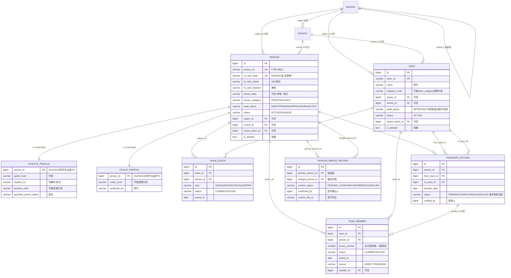
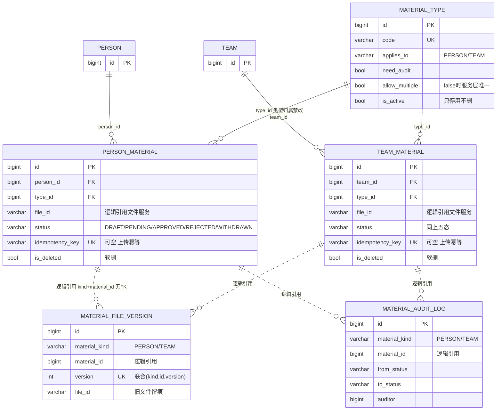
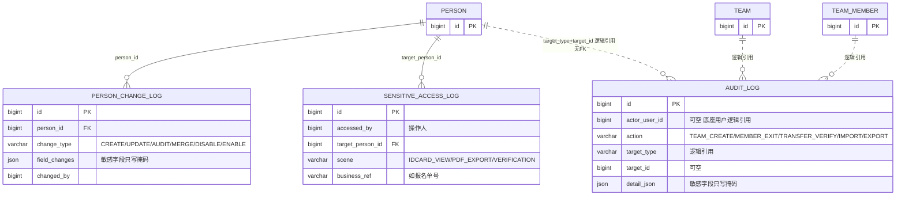
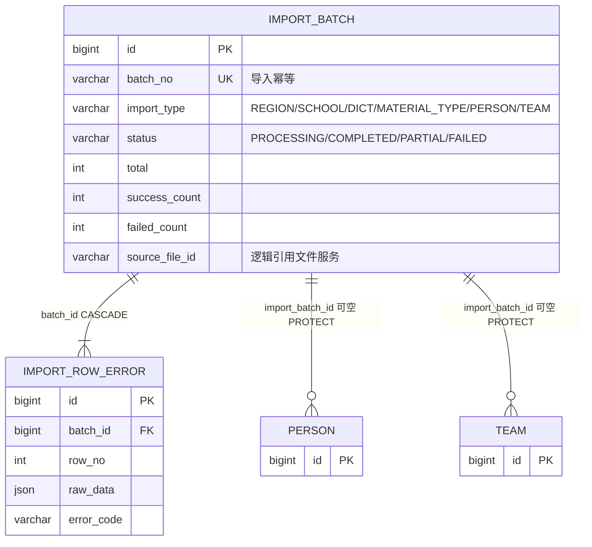
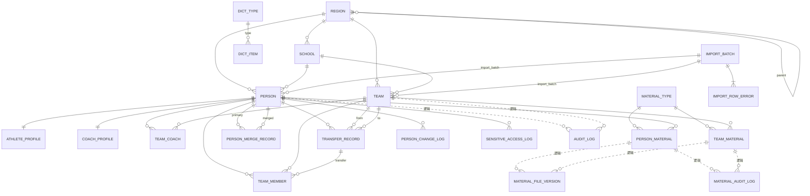

# 成员4 ER 图设计与数据库结构审核 V1.3

> 依据：《成员4数据库设计 V1.2 冻结候选版》（已完整重读核对，未做任何结构修改）
> 本版性质：ER 图定稿 + 结构审核报告。只做 ER 与审核，不写 Model / SQL / 代码。
> 图例：实线 `--` = 数据库外键；虚线 `..` = 逻辑引用（无数据库外键，应用层保证）。若渲染器不支持 `..`，可临时替换为 `--`，以标签文字为准。

---

## 一、22 张表完整清单（与 V1.2 二节逐一对齐，模块归属为审核标注，不改变表归属）

| # | Model | 表名 | 模块 | 关键角色 |
|---|-------|------|------|---------|
| 1 | Region | base_region | 基础数据 | 树形自关联 |
| 2 | School | base_school | 基础数据 | |
| 3 | DictType | base_dict_type | 基础数据 | |
| 4 | DictItem | base_dict_item | 基础数据 | 组别承载 |
| 5 | MaterialType | material_type | 基础数据（配置） | 材料引擎配置 |
| 6 | Person | person | 主数据 🔒 | 人员主档 |
| 7 | Team | team | 主数据 | 球队 |
| 8 | AthleteProfile | person_athlete_profile | 扩展档案 🔒 | 1:1 |
| 9 | CoachProfile | person_coach_profile | 扩展档案 | 1:1 |
| 10 | TeamMember | team_member | 关系表 | 球员↔球队，含历史 |
| 11 | TeamCoach | team_coach | 关系表 | 教练↔球队，含历史 |
| 12 | TransferRecord | team_transfer | 关系表（单据） | 转队 |
| 13 | PersonMergeRecord | person_merge_record | 单据/留痕 | 人员合并 |
| 14 | PersonMaterial | person_material | 材料实例 🔒 | |
| 15 | TeamMaterial | team_material | 材料实例 | |
| 16 | PersonChangeLog | person_change_log | 历史/审计 | append-only |
| 17 | MaterialAuditLog | material_audit_log | 历史/审计 | append-only |
| 18 | MaterialFileVersion | material_file_version | 历史/审计 | append-only |
| 19 | SensitiveAccessLog | sensitive_access_log | 历史/审计 | append-only |
| 20 | AuditLog | audit_log | 历史/审计 | append-only，无外键（设计取舍） |
| 21 | ImportBatch | import_batch | 导入 | |
| 22 | ImportRowError | import_row_error | 导入 | append-only |

模板遗留 `api_item`、`example_tag` 不属于业务库（落地时随 demo app 删除）。其他成员模块（User/File/Registration/Competition/Selection 等）不建表，仅逻辑引用。

## 二、各模块表关系说明

**基础数据模块**：Region 树形自关联（parent 可空=省级根）；Region→School（必填）；DictType→DictItem（必填，(type,value) 唯一）。MaterialType 独立配置表，被两张材料表引用。字典引用（category_code/position_code/coach_level 等）为 **code 逻辑引用，无 FK**（设计取舍，见审核清单 A4）。

**核心业务模块**：Person 经 OneToOne 挂两个扩展档案；Person↔Team 的 N:M 由 TeamMember（球员）与 TeamCoach（教练）两张关系表表达，关系行只做 CURRENT→EXITED 状态流转、永不删除；转队=TransferRecord 单据（from/to 两处 Team FK + Person FK），完成后在 from 队产生 EXITED 行、to 队产生 CURRENT 行（transfer_id 关联单据）；人员合并=PersonMergeRecord（primary/merged 双向 Person FK + 签字确认四字段）。

**档案与材料模块**：MaterialType 1:N 两张材料实例表（类型归属建后禁改）；材料替换由 MaterialFileVersion 记版本（多态逻辑引用 material_kind+material_id，无 FK）；审核历史入 MaterialAuditLog（同为多态逻辑引用）。

**历史追溯与审计模块**：PersonChangeLog / SensitiveAccessLog 直挂 Person FK；AuditLog 为通用流水，**无任何数据库外键**，靠 target_type+target_id 逻辑引用任意对象（已定稿取舍）。

**导入模块**：ImportBatch→ImportRowError（CASCADE，明细随批次）；ImportBatch 被 Person/Team 以可空 import_batch_id 反向引用（PROTECT）。

**连通性检查**：22 表中仅 AuditLog 无出边（故意设计）；其余全部连通。**无孤立表、无循环依赖**（TeamMember→TransferRecord 单向，TransferRecord 不回指；Region 自引用为树）。**无缺失外键**（缺失项均为已定稿的逻辑引用取舍）。

## 三、Mermaid ER 图源码

### 3.1 核心业务 ER 图

### 3.2 档案与材料 ER 图

### 3.3 历史追溯与审计 ER 图

### 3.4 导入批次与错误记录 ER 图

### 3.5 全库总览图（仅表与关系，不含字段）

## 四、外键关系清单（28 条：26 条与 V1.2 3.2 一致 + #27/#28 为 PMR 补录，见勘误 A7）

| # | 主表 | 从表 | 外键字段 | 基数 | 可空 | on_delete |
|---|------|------|---------|------|------|-----------|
| 1 | Region | Region | parent_id | 1:N | 是 | PROTECT |
| 2 | Region | School | region_id | 1:N | 否 | PROTECT |
| 3 | Region | Person | region_id | 1:N | 是 | PROTECT |
| 4 | Region | Team | region_id | 1:N | 是 | PROTECT |
| 5 | School | Person | school_id | 1:N | 是 | PROTECT |
| 6 | School | Team | school_id | 1:N | 是 | PROTECT |
| 7 | DictType | DictItem | type_id | 1:N | 否 | PROTECT |
| 8 | Person | AthleteProfile | person_id | 1:1 | 否 | **CASCADE** |
| 9 | Person | CoachProfile | person_id | 1:1 | 否 | **CASCADE** |
| 10 | Person | PersonChangeLog | person_id | 1:N | 否 | PROTECT |
| 11 | Person | PersonMaterial | person_id | 1:N | 否 | PROTECT |
| 12 | Person | TeamMember | person_id | 1:N | 否 | PROTECT |
| 13 | Team | TeamMember | team_id | 1:N | 否 | PROTECT |
| 14 | Person | TeamCoach | person_id | 1:N | 否 | PROTECT |
| 15 | Team | TeamCoach | team_id | 1:N | 否 | PROTECT |
| 16 | Person | TransferRecord | person_id | 1:N | 否 | PROTECT |
| 17 | Team | TransferRecord | from_team_id | 1:N | 否 | PROTECT |
| 18 | Team | TransferRecord | to_team_id | 1:N | 否 | PROTECT |
| 19 | TransferRecord | TeamMember | transfer_id | 1:N | 是 | PROTECT |
| 20 | MaterialType | PersonMaterial | type_id | 1:N | 否 | PROTECT |
| 21 | MaterialType | TeamMaterial | type_id | 1:N | 否 | PROTECT |
| 22 | Team | TeamMaterial | team_id | 1:N | 否 | PROTECT |
| 23 | Person | SensitiveAccessLog | target_person_id | 1:N | 否 | PROTECT |
| 24 | ImportBatch | ImportRowError | batch_id | 1:N | 否 | **CASCADE** |
| 25 | ImportBatch | Person | import_batch_id | 1:N | 是 | PROTECT |
| 26 | ImportBatch | Team | import_batch_id | 1:N | 是 | PROTECT |
| 27 | Person | PersonMergeRecord | primary_person_id | 1:N | 否 | PROTECT |
| 28 | Person | PersonMergeRecord | merged_person_id | 1:N | 否 | PROTECT |

统计：PROTECT 25 条，CASCADE 3 个外键（2 条规则：档案随主档、明细随批次），SET_NULL 0 条 —— 与定稿一致（#27/#28 为 A7 勘误补录）。

## 五、唯一约束与索引核对清单

### DB 层 UNIQUE（核对结论：**规则 9 条 / 约束 10 个**，口径差异见审核清单 A1）

| 表.字段 | 类型 | 核对 |
|---------|------|------|
| region.code | 单列 | ✅ |
| school.code | 单列（可空唯一，MySQL 多 NULL 合法） | ✅ |
| dict_type.code | 单列 | ✅ |
| material_type.code | 单列 | ✅ |
| person.id_card_hash | 单列（含软删行→复用不重建） | ✅ |
| person.person_no | 单列 | ✅ |
| team.team_no | 单列 | ✅ |
| person_material.idempotency_key | 单列（可空） | ✅ |
| team_material.idempotency_key | 单列（可空） | ✅ |
| import_batch.batch_no | 单列 | ✅ |

### DB 层联合 UNIQUE（3 个）
dict_item(type,value)、school(name,region)、material_file_version(material_kind,material_id,version) ✅

### 服务层强制唯一（6 条，**非数据库约束**，事务+行锁+条件更新保证；不得在 SQL 中实现为唯一索引）
1. (school, category_code) 现役唯一球队；2. person 全局现役唯一；3. (team, jersey_number) 现役唯一；4. (team, HEAD_COACH) 现役唯一；5. person 单条 PENDING 转队单；6. allow_multiple=false 时 (归属,type) 有效材料唯一。

### DB 层索引
person: full_name、(person_category,audit_status)、(status,is_deleted)、region、school、phone_hash、import_batch_id
team: name、(region,category_code)、school、(status,is_deleted)、import_batch_id
team_member/team_coach: (person,status)、(team,status)；team_member 另 (team,jersey_number)
team_transfer: (person,status)、from_team、to_team
person_material: (person,type,status)、(status,is_deleted)；team_material: (team,type,status)、(status,is_deleted)
person_change_log: (person,created_at)；material_audit_log: (material_kind,material_id)【material_file_version 由联合唯一键 (material_kind,material_id,version) 最左前缀覆盖，F5 决议删除冗余普通索引】
sensitive_access_log: (target_person,created_at)、(accessed_by,created_at)
audit_log: (target_type,target_id)、(actor_user_id,created_at)
import_row_error: (batch)
base_region: (parent,is_active)、(level)；base_dict_item: (type,is_active)；base_school: region、name
athlete_profile: student_no；coach_profile: certificate_no
无业务意义索引不建 ✅；**不建 DB CHECK**（定稿，应用层 choices+条件更新）✅

## 六、结构问题及风险清单

### A. 确定的问题（文档口径与表述，不改变任何表结构）

| # | 问题 | 证据 | 处理建议 |
|---|------|------|---------|
| A1 | UNIQUE 计数口径：V1.2 称"9 个单列 UNIQUE"，5.1 表实为 9 行，但 idempotency_key 一行覆盖 person_material/team_material 两张表 → **实际约束 10 个** | V1.2 5.1 表第 8 行 | 统一口径："9 条规则 / 10 个约束"；SQL 阶段按 10 个建 |
| A2 | CASCADE 表述口径："仅两处 CASCADE"实为 **2 条规则、3 个外键**（AthleteProfile、CoachProfile、ImportRowError） | V1.2 5.6；本报告四节 | 文档措辞统一为"2 规则/3 外键" |
| A3 | **多态逻辑引用无引用完整性**：material_audit_log / material_file_version 靠 (material_kind, material_id) 指向两张材料表，DB 层无法防悬挂引用 | V1.2 3.1 逻辑引用节 | 已定稿取舍；实现阶段增加定期一致性校验任务（不改结构） |
| A4 | **字典引用无 FK**：category_code / position_code / coach_level / guardian_relation 等以 code 字符串逻辑引用字典，code 失效无 DB 拦截 | V1.2 各表说明 | 已定稿取舍；SQL 建表注释中写明"引用 dict_item(type,value)，应用层校验" |
| A5 | **audit_log 无任何外键**：通用审计按设计取舍不建 FK | V1.2 5.6 + 审计节 | 维持；append-only + 部署层收回 UPDATE/DELETE 权限 |
| A6 | **"TeamCoach 与 TeamMember 同构"勘误（F1 决议，方案B）**：同构仅指结构形式，不代表必须拥有 transfer_id；team_transfer 仅用于运动员转队 | V1.2 四节"同构"字面 vs V1.3 外键清单#19 | 已定稿：team_coach 无 transfer_id，教练调岗历史由 team_coach 关系行 + audit_log（business_ref 关联跨队链路）追溯 |
| A7 | **外键总数勘误：26 → 28**。V1.2 3.2 关系明细表（V1.3 四节继承）漏列 person_merge_record 的 2 条外键（primary_person_id、merged_person_id → Person.PROTECT，均必填）；但 V1.2 PMR 字段表明确定义了这两个 FK，SQL 为忠实实现 | SQL 实计 28 vs 清单 26；V1.2 PMR 字段表 | 清单补录 #27/#28，总数修正为 28（PROTECT 25 + CASCADE 3 + SET_NULL 0）；**不改任何表结构**，V1.2 3.2 表以勘误记录不回改 |

### B. 需要业务确认的问题（均不阻塞 SQL 建表）

| # | 事项 | 影响 |
|---|------|------|
| B1 | ~~生产数据库~~ → **本轮已确认 MySQL 8.0 + utf8mb4 + DATETIME(6)**，按 MySQL 生成 DDL | 已关闭 |
| B2 | 学校管理员角色是否存在（V1.2 八节#2） | 只影响应用层必填校验与权限点，不影响表 |
| B3 | PDF 是否必须完整身份证号（V1.2 八节#3） | 影响明文接口实现；sensitive_access_log 表先建 |
| B4 | 球队审核流、Q6 反向转队、Q7 合并不撤销 的最终签字（V1.2 八节#4/5） | 应用层流程，不影响表 |

### C. 边界落实方式说明（审核要求项）

- "其他成员不得擅自创建主表"：数据库层无法禁止同库建表（除非分账号），**落实手段=应用架构单一写入口 + SQL 阶段为各成员建独立 DB 账号并仅授权本方表**（列入 SQL 阶段交付项）。
- 服务层 6 条唯一规则**不是**数据库约束，任何"用唯一索引实现现役唯一"的 SQL 提案都视为违反冻结设计（历史行需共存）。
- append-only 5 表（person_change_log、material_audit_log、material_file_version、sensitive_access_log、audit_log；import_row_error 同属）在 DB 账号权限层收回 UPDATE/DELETE。

## 七、最终结论

**【是否可以进入 SQL 建表阶段：是】**

- 22 表、28 条外键（A7 勘误后含 PMR×2）、10 单列 UNIQUE + 3 联合 UNIQUE、索引清单（含 F5 删减）、删除策略与 V1.2 冻结版一致，无结构性冲突；
- 审核发现 5 项均为**口径/取舍标注**（A1~A5），不需要修改任何表结构；
- 阻塞项：**无**。B2~B4 为应用层待确认，可在 SQL/Model 阶段并行；
- 进入 SQL 阶段的前置动作（仅文档口径修正，不改设计）：A1/A2 措辞统一；A3/A4 写入 SQL 注释与实现 TODO；"分账号权限"列入 SQL 交付项。

下一步（经你确认后）：生成 MySQL 8.0 建表 DDL **草案供审核**（只生成、不执行），包含 utf8mb4、DATETIME(6)、全部索引与 FK，以及各成员独立账号授权脚本框架。
