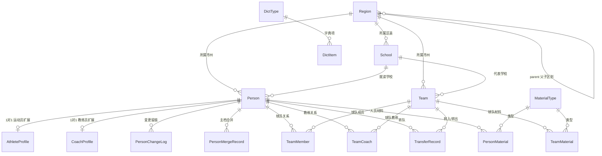

# 成员4后端总体设计 V1.0

> 项目：省级中小学足球赛事管理系统
> 范围：成员4（数据库总设计 / 人员档案中心 / 材料引擎 / 球队中心 / 管理员人员管理 / 管理员参赛查看 / 遴选档案聚合 / 联调回归）
> 状态：**待确认**（文档末尾"待确认问题清单"全部确认后升版 V1.1）
> 说明：本文档只做设计，**不含任何代码**。

> ⚠️ **技术栈核查结论（2026-10-20 已核实仓库事实）**
> 1. 框架：仓库使用 **Django Ninja**（`template-django-ninja-master`，uv.lock 锁定 django-ninja==1.3.0），全仓库**无任何 DRF 依赖**；
> 2. 版本：**Django==3.2.24**，pyproject 要求 **Python>=3.12**（注意：Django 3.2 官方仅支持 Python 3.6~3.10，3.12 存在兼容风险）；
> 3. 升级：按指示**不允许自行升级 Django 或修改现有依赖**。
> 结论：按"以现有项目仓库为准"，**推荐沿用 Django Ninja 现栈**；本设计的 Model/数据库/业务规则层与框架无关，仅 API 表达层（十二、十五）按最终锁定框架落地。
> 详见【待确认问题 #1、#2、#12】。

---

## 一、成员4职责边界

### 1.1 我负责什么

| # | 职责块 | 对应设计章节 |
|---|--------|-------------|
| 1 | 数据库总设计与初始化（ER/主表/公共字段/主外键/ID规则/字典/基础数据/软删/唯一约束/初始化脚本） | 三、四、五、九、十六 |
| 2 | 人员档案中心（运动员/教练员档案、注册、完善、修改、查询、唯一性校验、身份证去重、匹配合并、历史留痕） | 四、五、十 |
| 3 | 通用履历材料引擎（类型配置、人员/球队材料、增删改查、审核状态、权限、类型可扩展） | 八 |
| 4 | 球队中心（创建/修改/删除/查询、队旗队徽合照简介、成员管理、教练员管理、加入退出、转队、历史关系） | 六、八 |
| 5 | 管理员人员管理（搜索、姓名/身份证/类别/审核状态查询、增改删停、成员/教练查询、组合查询、分页） | 十二 |
| 6 | 管理员参赛查看（按市州/赛事类别/名称查球队、查看成员/教练/比赛关联信息） | 十二、十三 |
| 7 | 遴选档案聚合（按身份证/队伍查球员档案聚合，为其他成员提供人员/球队数据接口） | 十三 |
| 8 | 联调与回归（转队、历史数据、删除前关联检查、敏感隔离、与成员3/6联调） | 九、十三、十四、十七 |

### 1.2 我不负责什么（禁止实现进我的代码）

统一登录认证底座；权限基础框架；文件上传底座；消息通知；系统日志底座；报名主流程；报名审核流程；报名PDF/盖章材料生成；赛事编排；赛程生成；比赛场次管理；比赛结果录入；直播；技术统计；遴选评分；初选/复选评分；门户/CMS；公示展示；AI问答；前端页面。

### 1.3 需要调用其他成员的接口

| 依赖方 | 我方调用内容 | 契约要求 |
|--------|-------------|---------|
| 认证/权限成员 | 请求上下文注入：当前 user_id、角色、权限点、数据范围（如市州 scope） | 底座必须提供标准 request 上下文；我方只声明权限点清单，不实现鉴权 |
| 文件服务成员 | 上传文件 → 返回 file_id；由 file_id 换取下载/预览临时 URL | 我方只存 file_id + 文件名 + 大小 + 扩展名，绝不自建存储 |
| 成员3（报名） | 删除/停用人员、球队前的"报名引用计数"查询 | 成员3必须提供内部引用计数接口（契约见十三） |
| 成员5（赛事） | 删除/停用球队前的"赛事/比赛引用计数"查询；比赛相关展示信息 | 成员5必须提供内部引用计数接口 |
| 成员6（遴选） | 删除人员前的"遴选引用计数"查询 | 成员6必须提供内部引用计数接口 |

### 1.4 提供给其他成员的接口

| 使用方 | 提供内容 |
|--------|---------|
| 成员3 报名 | person_id / team_id 引用；报名所需人员、球队信息及快照字段集查询；报名资格校验；人员合并映射查询 |
| 成员5 赛事 | 球队信息查询（单个/批量）；球队与成员名单查询；球队停用/删除状态变更通知约定 |
| 成员6 遴选 | 身份证→人员查询（hash）；person_id→档案聚合；team_id→球队档案与名单；履历材料清单 |
| 公共 | 管理端统一人员/球队组合查询、分页接口 |

---

## 二、系统核心实体

### 2.1 成员4负责的实体

| 实体 | 表名 | 说明 |
|------|------|------|
| 人员主档 Person | person | 运动员/教练员统一主档，全系统唯一 |
| 运动员扩展档案 AthleteProfile | person_athlete_profile | 学段、学籍号、监护人等 |
| 教练员扩展档案 CoachProfile | person_coach_profile | 教练等级、证书等 |
| 人员变更日志 PersonChangeLog | person_change_log | 档案留痕（新增/修改/审核/合并/停用） |
| 人员合并记录 PersonMergeRecord | person_merge_record | 主档合并留痕 |
| 球队 Team | team | 全系统唯一球队主表 |
| 球员关系 TeamMember | team_member | person↔team 关系（含历史） |
| 教练关系 TeamCoach | team_coach | person↔team 教练关系（含历史） |
| 转队记录 TransferRecord | team_transfer | A队→B队流转记录 |
| 材料类型 MaterialType | material_type | 配置驱动，可动态扩展 |
| 人员材料 PersonMaterial | person_material | 人员履历材料 |
| 球队材料 TeamMaterial | team_material | 球队材料 |
| 材料审核历史 MaterialAuditLog | material_audit_log | 谁/何时/前后状态/意见 |
| 行政区划 Region | base_region | 省/市州/区县 |
| 学校 School | base_school | 学校基础数据 |
| 字典类型 DictType | base_dict_type | 统一枚举/可扩展字典 |
| 字典项 DictItem | base_dict_item | 字典值 |

### 2.2 其他成员负责的实体（我方只引用 ID，不建表不实现）

| 实体 | 归属 | 与我方关系 |
|------|------|-----------|
| 用户/角色/权限 User/Role/Permission | 认证权限成员 | 我方存储 created_by 等用户 ID（逻辑引用，不建外键） |
| 文件 File | 文件服务成员 | 我方仅存 file_id |
| 报名单/报名快照 Registration | 成员3 | 引用 person_id、team_id；快照由成员3存储 |
| 赛事/编排/场次/结果 Competition/Match/Result | 成员5 | 引用 team_id（及人员） |
| 遴选记录/评分 Selection/Score | 成员6 | 引用 person_id、team_id；评分数据不回流我方 |

---

## 三、完整ER关系设计



### 关系要点说明

1. **person 与运动员/教练员**：Person 为唯一主档，`person_category` 区分身份；AthleteProfile / CoachProfile 各以 OneToOne 挂接主档。主档承载公共字段（姓名/身份证/联系方式），身份差异字段全部下沉扩展表——**严禁大宽表**。
2. **person 与球队**：不直接多对多。通过关系表 `team_member`（球员）与 `team_coach`（教练）建立，关系表保存加入/离队时间与状态，历史关系永不删除。
3. **球队与成员**：Team 1—N TeamMember，成员表不冗余人员姓名等主档字段（列表展示走关联查询或调用方快照）。
4. **球队与教练员**：Team 1—N TeamCoach，同上；设"主教练唯一"业务规则（见十一）。
5. **材料与人员/球队**：MaterialType 配置驱动；PersonMaterial 外键 person、TeamMaterial 外键 team（**按你的要求拆两张表**，保证强外键、权限路径清晰）；文件本体只存 file_id。
6. **报名/赛事/遴选 与人员/球队**：报名（成员3）、赛事（成员5）、遴选（成员6）一律引用 person_id / team_id，**禁止另建运动员/球队主表**；报名/参赛时由调用方保存历史快照（契约见十三），当前档案变化不回写历史。

---

## 四、Django Model设计

### 4.0 全局统一约定（所有 Model 遵守）

| 约定 | 规则 |
|------|------|
| 主键 | `id = BigAutoField(primary_key=True)`，全系统统一自增长整型；禁止 UUID/雪花混用 |
| 业务编号 | 仅 Person（person_no）、Team（team_no）对人有业务编号；规则 = 前缀(P/T) + 年份 + id 按 8 位补零（事务内由 id 回填生成），全局唯一 |
| 外键 | 统一显式 `db_constraint=True`；核心关系用 `on_delete=PROTECT`（删除兜底拦截），扩展档案用 CASCADE |
| 公共字段 | 所有业务表继承 `created_at / updated_at`（DateTimeField，auto_now_add / auto_now） |
| 软删除 | Person、Team、PersonMaterial、TeamMaterial 继承 `is_deleted / deleted_at`；关系表、日志表、字典、基础数据**不做软删**（用状态或 is_active 表达） |
| 审计字段 | 关键表带 `created_by / updated_by`（BigInt，存认证底座用户 ID，逻辑引用，不建外键） |
| 状态枚举 | 统一使用字符串常量 choices（TextChoices），全系统同名状态含义一致，禁止 0/1/true/false/字符串混用 |
| 敏感字段 | 命名三件套：`*_cipher`（AES密文）/ `*_hash`（SHA256+盐，用于查重查询）/ `*_masked`（掩码展示） |
| 时间 | USE_TZ=True，UTC 存储，Asia/Shanghai 展示 |
| 表名 | 显式 `db_table`，业务表无前缀，基础数据 `base_` 前缀 |

> **created_by / updated_by 一期方案（2026-10-23 已确认执行）**：认证底座账号主键为字符串（`acc_xxx`），与 BIGINT 字段类型不兼容，因此一期**不写入**这两列、保持 NULL；操作人、操作时间、操作行为统一通过审计底座 `accounts_audit_log.operator_account_id`（CharField，存账号字符串主键）追溯，追溯链路已由 base-data 接口测试验证。后续如需填充业务表创建人/更新人，必须另行评审兼容方案（例如底座账号增加数字 uid 映射列，涉及底座 DDL 变更，需认证成员与团队共同确认），禁止把字符串主键直接写入 BIGINT 列。

### 4.1 Region（行政区划）

- Model：`Region`；表名：`base_region`
- 软删除：否（用 is_active）；敏感数据：无

| 字段 | 类型 | null/blank | 约束/默认 | 说明 |
|------|------|-----------|----------|------|
| id | BigAutoField | — | PK | |
| name | CharField(50) | 否 | | 名称，如"贵阳市" |
| code | CharField(12) | 否 | **unique** | 国标行政区划代码 |
| level | SmallIntegerField | 否 | choices：1省/2市州/3区县 | |
| parent | ForeignKey(self) | 是 | on_delete=PROTECT | 上级区划 |
| sort_order | IntegerField | 否 | default=0 | |
| is_active | BooleanField | 否 | default=True | |
| created_at/updated_at | DateTimeField | — | 自动 | |

关系：self父子；被 Person/Team/School 引用。
索引：`(parent, is_active)`、`(level)`。

### 4.2 School（学校）

- Model：`School`；表名：`base_school`
- 软删除：否（is_active）；敏感数据：无

| 字段 | 类型 | null/blank | 约束/默认 | 说明 |
|------|------|-----------|----------|------|
| id | BigAutoField | — | PK | |
| name | CharField(100) | 否 | | 学校名称 |
| code | CharField(20) | 是 | unique（允许NULL） | 教育部学校标识码 |
| school_type | CharField(20) | 否 | choices：PRIMARY/JUNIOR/SENIOR/NINE_YEAR/COMPLETE/MIDDLE_VOC | 学段类型 |
| region | ForeignKey(Region) | 否 | PROTECT | 所属区县 |
| address | CharField(200) | 是 | | |
| is_active | BooleanField | 否 | default=True | |
| created_at/updated_at | DateTimeField | — | 自动 | |

唯一约束：`(name, region)` —— 同区县内学校名不重复。
索引：`region`、`name`。

### 4.3 DictType / DictItem（字典）

- Model：`DictType` 表 `base_dict_type`；`DictItem` 表 `base_dict_item`；软删除：否（is_active）

| DictType 字段 | 类型 | 约束 | 说明 |
|------|------|------|------|
| id | BigAutoField | PK | |
| code | CharField(50) | **unique** | 如 position / team_category / guardian_relation |
| name | CharField(100) | | |
| remark | CharField(200) | blank | |

| DictItem 字段 | 类型 | null/blank | 约束 | 说明 |
|------|------|-----------|------|------|
| id | BigAutoField | — | PK | |
| type | ForeignKey(DictType) | 否 | PROTECT | |
| value | CharField(50) | 否 | **unique(type, value)** | 稳定编码，禁止变更含义 |
| label | CharField(100) | 否 | | 展示名 |
| sort_order | IntegerField | 否 | default=0 | |
| is_active | BooleanField | 否 | default=True | |

索引：`(type, is_active)`。
设计原则：**业务枚举用 choices（状态类），可扩展枚举用字典（位置、组别、关系等）**。

### 4.4 Person（人员主档）★核心

- Model：`Person`；表名：`person`
- 软删除：**是**；敏感数据：**是（身份证、手机号）**

| 字段 | 类型 | null/blank | 约束/默认 | 说明 |
|------|------|-----------|----------|------|
| id | BigAutoField | — | PK | |
| person_no | CharField(20) | 否 | **unique** | 业务档案号 P+年份+8位id |
| full_name | CharField(50) | 否 | | 姓名 |
| gender | SmallIntegerField | 否 | choices：0未知/1男/2女 | 由身份证解析 |
| birth_date | DateField | 是 | | 由身份证解析 |
| id_card_cipher | CharField(256) | 否 | | 身份证AES密文 🔒 |
| id_card_hash | CharField(64) | 否 | **unique** | SHA256(身份证+盐) 🔒 |
| id_card_masked | CharField(18) | 否 | | 如 522401********0012 |
| phone_cipher | CharField(256) | 是 | | 手机号密文 🔒 |
| phone_hash | CharField(64) | 是 | index | 手机号精确查重 🔒 |
| phone_masked | CharField(11) | 是 | | 138****5678 🔒 |
| person_category | CharField(20) | 否 | choices：ATHLETE/COACH（预留OTHER） | 人员类别 |
| audit_status | CharField(20) | 否 | default=DRAFT；choices：DRAFT/PENDING/APPROVED/REJECTED | 审核状态 |
| status | CharField(20) | 否 | default=ACTIVE；choices：ACTIVE/DISABLED | 启用/停用 |
| region | ForeignKey(Region) | 是 | PROTECT | 所属市州 |
| school | ForeignKey(School) | 是 | PROTECT | 所属学校（教练员可空） |
| photo_file_id | CharField(64) | 是 | | 证件照 file_id |
| remark | TextField | 是(blank) | | 备注 |
| created_by / updated_by | BigIntegerField | 是 | | 底座用户ID |
| is_deleted / deleted_at | BooleanField / DateTimeField | — | default=False / null | 软删除 |

唯一约束：`id_card_hash`（全局，含软删数据——**重复注册复用原档案，不新建**）；`person_no`。
索引：`full_name`、`(person_category, audit_status)`、`(status, is_deleted)`、`school`、`region`、`phone_hash`。

### 4.5 AthleteProfile（运动员扩展档案）

- Model：`AthleteProfile`；表名：`person_athlete_profile`
- 软删除：否（随主档）；敏感数据：监护人手机号 🔒

| 字段 | 类型 | null/blank | 约束/默认 | 说明 |
|------|------|-----------|----------|------|
| person | OneToOneField(Person) | — | PK，CASCADE | 主档即主键 |
| grade_level | CharField(20) | 否 | choices：PRIMARY_LOW/PRIMARY_HIGH/JUNIOR/SENIOR | 学段 |
| student_no | CharField(30) | 是 | index | 学籍号（非全局唯一，仅索引） |
| position_code | CharField(20) | 是 | | 场上位置，字典 position |
| guardian_name | CharField(50) | 是 | | 监护人姓名 |
| guardian_relation | CharField(20) | 是 | | 字典 guardian_relation |
| guardian_phone_cipher / _hash / _masked | 同主档三件套 | 是 | | 监护人电话 🔒 |
| ext_json | JSONField | 是(blank) | | 预留扩展（身高体重等），禁止塞高频查询字段 |

### 4.6 CoachProfile（教练员扩展档案）

- Model：`CoachProfile`；表名：`person_coach_profile`；软删除：否

| 字段 | 类型 | null/blank | 约束/默认 | 说明 |
|------|------|-----------|----------|------|
| person | OneToOneField(Person) | — | PK，CASCADE | |
| coach_level | CharField(20) | 是 | | 教练等级，字典 coach_level |
| certificate_no | CharField(50) | 是 | index | 教练员证书编号 |
| certificate_expire_date | DateField | 是 | | 证书有效期 |
| ext_json | JSONField | 是(blank) | | 预留 |

### 4.7 PersonChangeLog（人员变更留痕）

- Model：`PersonChangeLog`；表名：`person_change_log`；**append-only，禁止 update/delete**

| 字段 | 类型 | 约束/默认 | 说明 |
|------|------|----------|------|
| id | BigAutoField | PK | |
| person | ForeignKey(Person) | PROTECT | |
| change_type | CharField(20) | choices：CREATE/UPDATE/AUDIT/MERGE/DISABLE/ENABLE | |
| field_changes | JSONField | | [{field, old, new}]，**敏感字段只写掩码** |
| changed_by | BigIntegerField | null | 操作人 |
| reason | CharField(200) | blank | 变更原因 |
| created_at | DateTimeField | auto | |

索引：`(person, created_at)`。

### 4.8 PersonMergeRecord（人员合并记录）

| 字段 | 类型 | 约束 | 说明 |
|------|------|------|------|
| id | BigAutoField | PK | |
| primary_person | ForeignKey(Person) | PROTECT，related_name=merges_kept | 保留主档 |
| merged_person | ForeignKey(Person) | PROTECT | 被合并档案（合并后软删） |
| merged_by | BigIntegerField | | 操作人 |
| reason | CharField(200) | | 合并原因 |
| confirm_status | CharField(20) | default=PENDING_CONFIRM；choices：PENDING_CONFIRM/CONFIRMED/CANCELLED | 签字确认状态（#8 已确认原则：生效前需队伍/核心成员确认） |
| confirmed_by | BigIntegerField | null | 确认人 |
| confirmed_at | DateTimeField | null | 确认时间 |
| confirm_file_id | CharField(64) | null | 签字确认凭证 file_id |
| created_at | DateTimeField | auto | |

> 合并映射查询接口（merged_id → primary_id）**仅在 confirm_status=CONFIRMED 后生效**；确认前被合并档案保持原状，服务层锁定禁止并发修改。

### 4.9 Team（球队）★核心

- Model：`Team`；表名：`team`；软删除：**是**

| 字段 | 类型 | null/blank | 约束/默认 | 说明 |
|------|------|-----------|----------|------|
| id | BigAutoField | — | PK | |
| team_no | CharField(20) | 否 | **unique** | T+年份+8位id |
| name | CharField(100) | 否 | | 球队名称 |
| category_code | CharField(20) | 否 | | 赛事组别，字典 team_category（与成员5对齐） |
| region | ForeignKey(Region) | 是 | PROTECT | 所属市州 |
| school | ForeignKey(School) | 是 | PROTECT | 代表学校 |
| logo_file_id | CharField(64) | 是 | | 队徽 file_id |
| flag_file_id | CharField(64) | 是 | | 队旗 file_id |
| group_photo_file_id | CharField(64) | 是 | | 合照 file_id |
| introduction | TextField | 是(blank) | | 球队简介 |
| audit_status | CharField(20) | 否 | default=DRAFT | 同人员审核枚举（是否启用见待确认#5） |
| status | CharField(20) | 否 | default=ACTIVE | ACTIVE/DISABLED |
| created_by / updated_by | BigIntegerField | 是 | | |
| is_deleted / deleted_at | | — | | 软删除 |

唯一约束：`team_no`。
业务唯一（服务层强制，原因见 4.9 注）：`(school, category_code)` 现役唯一——同一学校同一组别只允许一支现役球队。
索引：`name`、`(region, category_code)`、`school`、`(status, is_deleted)`。

> 注：MySQL 不支持条件唯一索引（仅对 is_deleted=0 生效的唯一），为保可移植性，该规则由 Service 层 + 事务锁强制，数据库仅建普通索引。**一致性优先（约束14）**。

### 4.10 TeamMember（球员关系）★核心

- Model：`TeamMember`；表名：`team_member`
- 软删除：**否**——历史关系只能置 EXITED，永不删除、永不改写
- 敏感数据：无（球衣号/位置非敏感）

| 字段 | 类型 | null/blank | 约束/默认 | 说明 |
|------|------|-----------|----------|------|
| id | BigAutoField | — | PK | |
| team | ForeignKey(Team) | 否 | PROTECT | |
| person | ForeignKey(Person) | 否 | PROTECT | 服务层校验 person_category=ATHLETE |
| jersey_number | SmallIntegerField | 是 | | 球衣号，队内现役唯一（服务层强制） |
| position_code | CharField(20) | 是 | | 字典 position |
| status | CharField(20) | 否 | default=CURRENT；choices：CURRENT/EXITED | 关系状态 |
| joined_at | DateField | 否 | | 加入时间 |
| left_at | DateTimeField | 是 | | 离队时间 |
| left_reason | CharField(200) | blank | | 离队原因（含"转队"） |
| source | CharField(20) | 否 | default=DIRECT；choices：DIRECT/TRANSFER | 关系来源 |
| transfer | ForeignKey(TransferRecord) | 是 | PROTECT | 由转队产生时关联 |
| created_by | BigIntegerField | 是 | | |
| created_at / updated_at | | — | | |

索引：`(person, status)`、`(team, status)`、`(team, jersey_number)`。
无数据库级唯一约束（"同一人仅一支现役球队"需允许历史重复行，条件唯一不可移植）→ Service 层事务锁强制。

### 4.11 TeamCoach（教练关系）

- Model：`TeamCoach`；表名：`team_coach`
- 结构与 TeamMember 同构，差异字段：

| 差异字段 | 类型 | 说明 |
|---------|------|------|
| person | FK(Person) | 服务层校验 person_category=COACH |
| duty | CharField(20) | choices：HEAD_COACH/ASSISTANT_COACH/GOALKEEPER_COACH |
| （无 jersey_number） | | |

业务规则：每队现役**主教练唯一**（服务层强制）；索引：`(person, status)`、`(team, status)`。

### 4.12 TransferRecord（转队记录）

- Model：`TransferRecord`；表名：`team_transfer`；软删除：否（只能 CANCELLED）

| 字段 | 类型 | null/blank | 约束/默认 | 说明 |
|------|------|-----------|----------|------|
| id | BigAutoField | — | PK | |
| person | ForeignKey(Person) | 否 | PROTECT | |
| from_team | ForeignKey(Team) | 否 | PROTECT，related_name=transfers_out | 转出队 |
| to_team | ForeignKey(Team) | 否 | PROTECT，related_name=transfers_in | 转入队 |
| transfer_date | DateField | 否 | | 生效日期 |
| apply_reason | CharField(200) | 否 | | 转队原因 |
| status | CharField(20) | 否 | default=PENDING；choices：PENDING/COMPLETED/CANCELLED | 流转见十一 |
| completed_at | DateTimeField | 是 | | 完成时间 |
| verified_by | BigIntegerField | 是 | | 核验人（赛事管理员，#6 已确认原则：核验后直办） |
| verified_at | DateTimeField | 是 | | 核验时间 |
| created_by | BigIntegerField | 是 | | |
| created_at / updated_at | | — | | |

索引：`(person, status)`、`from_team`、`to_team`。
校验：from_team ≠ to_team；person 现役于 from_team；person 不现役于 to_team；同一人同时仅允许一条 PENDING（服务层强制）。

### 4.13 MaterialType（材料类型配置）

- Model：`MaterialType`；表名：`material_type`；软删除：否（is_active）

| 字段 | 类型 | null/blank | 约束/默认 | 说明 |
|------|------|-----------|----------|------|
| id | BigAutoField | — | PK | |
| code | CharField(50) | 否 | **unique** | 如 STUDENT_STATUS / INSURANCE / COACH_CERT / TRANSFER_CERT |
| name | CharField(100) | 否 | | 类型名 |
| applies_to | CharField(20) | 否 | choices：PERSON/TEAM | 适用归属 |
| is_required | BooleanField | 否 | default=False | 报名场景是否必传（供成员3读取） |
| need_audit | BooleanField | 否 | default=True | 是否需要审核 |
| allow_multiple | BooleanField | 否 | default=False | 同归属是否允许多份 |
| allowed_ext | CharField(200) | 否 | default="jpg,jpeg,png,pdf" | 扩展名白名单 |
| max_size_mb | SmallIntegerField | 否 | default=10 | 单文件上限 |
| sort_order | IntegerField | 否 | default=0 | |
| is_active | BooleanField | 否 | default=True | |
| remark | CharField(200) | blank | | |

### 4.14 PersonMaterial（人员材料）

- Model：`PersonMaterial`；表名：`person_material`
- 软删除：**是**；敏感数据：**是（材料文件内容，如学籍/证书）**

| 字段 | 类型 | null/blank | 约束/默认 | 说明 |
|------|------|-----------|----------|------|
| id | BigAutoField | — | PK | |
| person | ForeignKey(Person) | 否 | PROTECT | |
| type | ForeignKey(MaterialType) | 否 | PROTECT | 服务层校验 applies_to=PERSON |
| file_id | CharField(64) | 否 | | 文件服务ID（不存文件本体） |
| file_name | CharField(200) | 否 | | 原始文件名 |
| file_size | IntegerField | 是 | | 字节 |
| file_ext | CharField(10) | 是 | | 扩展名 |
| status | CharField(20) | 否 | default=DRAFT；choices：DRAFT/PENDING/APPROVED/REJECTED/WITHDRAWN | 统一材料状态 |
| audit_remark | CharField(200) | blank | | 审核意见 |
| audited_by | BigIntegerField | 是 | | 审核人 |
| audited_at | DateTimeField | 是 | | 审核时间 |
| uploaded_by | BigIntegerField | 是 | | 上传人 |
| remark | CharField(200) | blank | | |
| is_deleted / deleted_at | | — | | 软删除 |

索引：`(person, type, status)`、`(status, is_deleted)`。
"同类型唯一"（allow_multiple=False）：服务层强制（条件唯一不可移植）。

### 4.15 TeamMaterial（球队材料）

- Model：`TeamMaterial`；表名：`team_material`
- 与 PersonMaterial 同构，`person` 换为 `team = ForeignKey(Team, PROTECT)`；索引 `(team, type, status)`。

### 4.16 MaterialAuditLog（材料审核历史）

- Model：`MaterialAuditLog`；表名：`material_audit_log`；**append-only**

| 字段 | 类型 | 约束/默认 | 说明 |
|------|------|----------|------|
| id | BigAutoField | PK | |
| material_kind | CharField(20) | choices：PERSON/TEAM | 覆盖两张材料表，逻辑引用 |
| material_id | BigIntegerField | | 材料ID（不建外键，两张表无法共用FK） |
| from_status | CharField(20) | | 原状态 |
| to_status | CharField(20) | | 新状态 |
| auditor | BigIntegerField | | 审核人 |
| comment | CharField(200) | blank | 审核意见 |
| created_at | DateTimeField | auto | |

索引：`(material_kind, material_id)`。

### 4.17 SensitiveAccessLog（敏感访问审计）

- Model：`SensitiveAccessLog`；表名：`sensitive_access_log`；**append-only**（支撑 #11 明文出口审计，若最终决定完全不开明文出口则此表可省略）

| 字段 | 类型 | 约束/默认 | 说明 |
|------|------|----------|------|
| id | BigAutoField | PK | |
| accessed_by | BigIntegerField | | 访问人（底座用户ID） |
| target_person | ForeignKey(Person) | PROTECT | 被查看人员 |
| scene | CharField(50) | | 场景：IDCARD_VIEW / PDF_EXPORT / INTERNAL_API 等 |
| ip_address | GenericIPAddressField | null | 来源地址 |
| created_at | DateTimeField | auto | |

索引：`(target_person, created_at)`、`accessed_by`。

### 4.18 遴选档案聚合

**不建任何表**。纯只读聚合 API：组合 Person + Profile + 现役/历史球队关系 + 已审核材料清单。遴选评分数据由成员6存储，我方不重复维护。

---

## 五、人员唯一性

| # | 设计项 | 方案 |
|---|--------|------|
| 1 | 身份证唯一 | 归一化（去空格、末位x转大写）→ SHA256 → `id_card_hash` 全局唯一索引。数据库层硬约束，任何路径（新增/合并/恢复）都绕不过 |
| 2 | 身份证加密 | AES-256-GCM，密钥来自环境变量（FIELD_ENCRYPT_KEY），按环境隔离；密文 Base64 存 `id_card_cipher`。仅 Service 层可解密，禁止在 Serializer/日志层出现明文 |
| 3 | 身份证Hash | SHA256(身份证 + ID_HASH_SALT)，盐独立于加密密钥；用于唯一性校验与"按身份证查询"（无需解密即可精确命中） |
| 4 | 重复注册 | 新建时 hash 命中已存在 → 报错 PERSON_IDCARD_DUPLICATE（409），并返回已存在档案的掩码摘要，供管理员选择"查看原档案 / 发起合并"；**若原档案已软删，同样拒绝新建**——恢复须走"恢复档案"操作，保证历史链完整 |
| 5 | 人员匹配 | 匹配接口支持：身份证精确（hash）+ 姓名精确/模糊 + 出生年月组合，返回候选集及相似依据（同名/同校/同出生日期），供人工确认合并 |
| 6 | 人员合并 | 指定 primary 与 merged：①迁移 merged 的 TeamMember/TeamCoach/PersonMaterial/TransferRecord 外键指向 primary；②merged 软删；③写 PersonMergeRecord + 双方 PersonChangeLog(MERGE)；④全程单事务 |
| 7 | 合并后历史数据 | **推荐方案：外部历史表（报名/遴选）保留原 person_id 不改写，通过"合并映射查询接口"解析**（merged_id → primary_id）。理由：不跨成员改数据、可追溯、失败可回滚。外部模块在查询时先调映射接口；如团队选择"批量改写引用"方案，由各成员自行迁移并自担一致性（见待确认#8） |

---

## 六、球队与人员关系

| # | 场景 | 规则 |
|---|------|------|
| 1 | 加入球队 | 校验：人员 APPROVED + ACTIVE + 类别匹配 + 不在任何球队现役（推荐规则，见待确认#3）→ 新建 TeamMember(status=CURRENT, joined_at) |
| 2 | 离开球队 | CURRENT → EXITED，写 left_at + left_reason；**行不删除**；球衣号保留（历史完整性） |
| 3 | 转队 | 见 4.12：PENDING → 完成时旧关系置 EXITED（left_at=transfer_date，reason=转队，关联 transfer），新队新建 TeamMember(source=TRANSFER, joined_at=transfer_date)；新旧加入/离队时间一致衔接 |
| 4 | 重复加入 | 同队已有 CURRENT 关系 → MEMBER_ALREADY_IN_TEAM（409）；同队 EXITED 历史不阻止再次加入（新行） |
| 5 | 历史球队关系 | TeamMember 全量保留，`(person, status)` 索引支撑"现役/历史"查询；历史关系只读，任何接口不允许修改 EXITED 行 |
| 6 | 当前 vs 历史 | 当前 = status=CURRENT（理论至多1条）；历史 = EXITED。报名/遴选模块引用"当前球队"用现役查询接口，引用"参赛时球队"必须用他们自己的快照 |

---

## 七、历史快照

| # | 问题 | 设计 |
|---|------|------|
| 1 | 报名时保存什么快照 | **快照由成员3存储**。我方提供"报名上下文"内部接口，一次性返回约定字段集：人员（姓名/性别/出生日期/身份证掩码/学段/学籍号/学校名/市州名/球衣号/位置）+ 球队（名称/组别/学校名/市州名）。字段清单写死在契约文档中，新增字段走契约变更流程 |
| 2 | 人员资料修改后历史报名是否变化 | **不变**。快照在成员3侧落库时固化；我方修改主档只影响后续查询，且每次修改写 PersonChangeLog |
| 3 | 球队资料修改后历史报名是否变化 | 同上，不变 |
| 4 | 比赛历史如何保存 | 比赛数据归成员5，同样以 team_id/person_id + 快照方式固化；我方仅提供档案查询，不存比赛数据 |
| 5 | 如何保证历史不被当前档案污染 | 三条铁律：①历史业务表禁止反向 UPDATE 我方主档；②我方任何写操作不触达他人业务表（合并例外按契约#8处理）；③主档变更只允许"追加变更日志"，不允许物理覆盖式替换关键字段（身份证永不修改——如确需纠错走"作废重建"流程并留痕） |

---

## 八、通用履历材料引擎

| # | 设计项 | 方案 |
|---|--------|------|
| 1 | material_type | 配置表驱动：类型编码、适用归属（PERSON/TEAM）、是否必传、是否需审核、是否可多份、扩展名白名单、大小上限。**新增材料类型 = 插入一行配置** |
| 2 | person_material / team_material | 按你的要求拆两张表（外键强约束、权限与查询路径清晰）；审核历史统一存 MaterialAuditLog（kind + id 逻辑引用） |
| 3 | 材料审核状态 | DRAFT → PENDING → APPROVED / REJECTED；REJECTED 可修改后重新 PENDING；APPROVED 可 WITHDRAWN（撤回）；WITHDRAWN 可重新提交。流转规则见十一 |
| 4 | 材料删除 | 软删除（is_deleted），审核历史与引用关系保留；物理文件由文件服务管理生命周期，我方不删 |
| 5 | 材料权限 | 上传/修改/删除：本人或管理员（材料归属人维度）；查看：本人 + 持有 material:view 权限的管理员；审核：material:audit 权限。敏感材料（学籍/证书）查看需 material:view_sensitive（见十） |
| 6 | 新增类型是否要改代码 | **不需要**。接口按 type code 通用处理，校验参数全部来自配置；仅当出现全新交互形态（如视频在线预览）才需要代码增强，属可预期演进 |

---

## 九、删除与停用规则

### 9.1 删除 vs 停用矩阵

| 数据 | 允许的操作 | 说明 |
|------|-----------|------|
| Person | 停用/启用、软删除 | 有历史业务数据 → 只能停用；无任何关联 → 可软删 |
| Team | 停用/启用、软删除 | 同上 |
| PersonMaterial / TeamMaterial | 软删除 | 任何时候软删，留痕 |
| TeamMember / TeamCoach | 仅状态流转（EXITED） | **永不删除**；错录走"纠错"服务并留日志 |
| TransferRecord | 仅 CANCELLED | 永不删除 |
| 各类日志表 | 只增不改不删 | append-only |
| Dict/Region/School/MaterialType | 仅停用（is_active=False） | 基础数据永不物理删除 |

### 9.2 删除前关联检查（我方域内 + 跨成员契约）

**删除/停用 Person 前检查**：现役球队关系、进行中转队（PENDING）、未终态材料（非APPROVED/WITHDRAWN/REJECTED终态）、软删子档案；跨成员：报名引用（成员3）、遴选引用（成员6）、比赛引用（成员5）。
**删除/停用 Team 前检查**：现役成员/教练、PENDING 转队、材料；跨成员：报名引用（成员3）、赛事引用（成员5）。

实现方式：我方提供"删除前检查"聚合服务，串行调用各成员的**引用计数内部接口**（契约见十三）；任一引用 > 0 → 拒绝软删，提示改用停用。

### 9.3 存在历史业务数据时

一律**只允许停用（DISABLED）**：停用后不可被新业务引用（报名资格校验接口会返回不合格），但历史查询不受影响。

---

## 十、敏感数据与权限

### 10.1 敏感字段清单

| 数据 | 存储形态 | API 返回形态 |
|------|---------|-------------|
| 身份证 | cipher + hash + masked | 列表/详情一律 masked；明文仅"查看身份证"专用接口（独立权限点 + 审计留痕） |
| 手机号 | cipher + hash + masked | 一律 masked |
| 监护人手机号 | 同上 | 一律 masked |
| 学籍号 | 明文（非高敏） | 详情可见；列表不返回 |
| 证件照 | file_id | 经文件服务临时URL，需鉴权 |
| 学籍/证书等材料文件 | file_id | 临时URL，按材料权限控制 |

### 10.2 角色可见性矩阵（权限点由认证成员实现，我方声明并执行 queryset 过滤）

| 角色 | 人员列表 | 人员详情 | 身份证明文 | 材料查看 | 材料审核 | 档案管理 | 数据范围 |
|------|---------|---------|-----------|---------|---------|---------|---------|
| 系统管理员 | ✅ | ✅ | ✅（留痕） | ✅ | ✅ | ✅ | 全部 |
| 市州管理员 | ✅ | ✅ | ❌ | ✅（本区域） | ✅（本区域） | ✅（本区域） | 本市州 scope |
| 普通用户 | ❌ | 仅本人 | ❌ | 仅本人材料 | ❌ | ❌ | 本人 |
| 队伍负责人（预留） | ❌ | 本队名单（非敏感字段） | ❌ | ❌ | ❌ | ❌ | 本队 |

### 10.3 日志红线

日志（含第三方日志底座）禁止出现：明文身份证、明文手机号、监护人电话、材料文件内容、完整请求体中的敏感字段。要求：日志脱敏过滤器按字段名单（id_card/phone/guardian_phone）统一替换为掩码；异常信息不回显敏感原文。

---

## 十一、审核与状态（统一枚举）

### 11.1 全系统统一枚举表

| 枚举 | 取值 | 使用位置 |
|------|------|---------|
| AuditStatus | DRAFT / PENDING / APPROVED / REJECTED | Person.audit_status、Team.audit_status |
| EntityStatus | ACTIVE / DISABLED | Person.status、Team.status |
| MaterialStatus | DRAFT / PENDING / APPROVED / REJECTED / WITHDRAWN | PersonMaterial、TeamMaterial |
| RelationStatus | CURRENT / EXITED | TeamMember、TeamCoach |
| TransferStatus | PENDING / COMPLETED / CANCELLED | TransferRecord |
| PersonCategory | ATHLETE / COACH（预留 OTHER） | Person |
| ChangeType | CREATE / UPDATE / AUDIT / MERGE / DISABLE / ENABLE | PersonChangeLog |
| JoinSource | DIRECT / TRANSFER | TeamMember.source |
| MaterialKind | PERSON / TEAM | MaterialAuditLog |

### 11.2 状态流转规则

**审核状态（Person / Team / Material 通用）**
- DRAFT → PENDING：提交人（人员由管理员代提交）
- PENDING → APPROVED / REJECTED：持有审核权限者；写审核留痕（人员入 PersonChangeLog，材料入 MaterialAuditLog）
- REJECTED → PENDING：修改后重新提交
- APPROVED → WITHDRAWN：仅材料有此状态（上传者/管理员撤回）
- 非法流转（如 APPROVED → DRAFT）一律 409 STATE_INVALID

**关系状态**：CURRENT → EXITED（单向，不可逆）；再次加入 = 新行。
**转队状态**：PENDING → COMPLETED（执行转队事务）/ PENDING → CANCELLED（撤销）；COMPLETED/CANCELLED 终态不可变。
**停用**：ACTIVE ↔ DISABLED；DISABLED 实体不能进入任何新业务（新关系、新转队、新提交报名校验）。

---

## 十二、查询与分页（DRF 实现方式）

### 12.1 人员组合查询（管理员）

| 条件 | 匹配方式 | ORM 实现要点 |
|------|---------|-------------|
| 姓名 | 模糊 | full_name__icontains |
| 身份证 | **仅支持完整18位精确** | 归一化→hash→id_card_hash 精确匹配（hash 无法模糊，属安全设计而非缺陷，需产品知悉） |
| 人员类别 | 精确 | person_category |
| 审核状态 | 精确/多选 | audit_status__in |
| 启停状态 | 精确 | status |
| 学校 | 精确 | school_id |
| 市州 | 精确（可选含下级） | region_id；include_children=true 时先取子区划 id 集合再 __in |
| 球队 | 精确 | 通过 TeamMember 关系子查询（含"现役/历史"过滤参数） |
| 时间范围 | 区间 | created_at__range |

实现：django-filter 的 FilterSet 声明字段；queryset 默认过滤 `is_deleted=False`；`select_related("school","region")`、列表避免 N+1（profiles 用 prefetch）。FilterSet 与分页/排序解耦。

### 12.2 球队组合查询（管理员参赛查看）

按市州 / 赛事类别（字典 team_category）/ 名称模糊 / 学校 / 状态组合；球队详情聚合返回：现役成员列表、现役教练列表、材料清单、关联比赛信息（**比赛信息来自成员5接口聚合展示，我方不存比赛数据**）。

### 12.3 分页与排序

- 统一自定义 PageNumberPagination：`page` 默认 1，`page_size` 默认 20、上限 100；非法分页参数返回 400 PAGE_INVALID（覆写 DRF 默认 404 行为）
- 响应结构：`{items, total, page, page_size, total_pages}`
- 排序：OrderingFilter + 白名单（created_at / -created_at / full_name / name），白名单外参数 400
- 姓名排序按 Unicode 序（中文拼音序需数据库 collation 支持，暂不引入额外依赖）

---

## 十三、跨成员接口

### 13.1 与成员3（报名模块）

| 项 | 契约 |
|----|------|
| 识别键 | 报名单必须引用 person_id、team_id；**禁止自建运动员/球队表** |
| 我方提供 | ①报名上下文快照字段集查询（单人/单队/批量）；②报名资格校验（人员 APPROVED+ACTIVE+无现役冲突；球队 ACTIVE）；③合并映射查询 merged_id→primary_id |
| 对方义务 | 落库时保存人员/球队快照；档案变更不影响历史报名；删除/停用前调用我方检查编排 |
| 敏感字段 | 快照中身份证只给**掩码**；如PDF生成需明文，须走专用内部接口（权限+留痕），见待确认#11 |

### 13.2 与成员5（赛事模块）

| 项 | 契约 |
|----|------|
| 识别键 | 赛程/场次/结果引用 team_id |
| 我方提供 | 球队信息查询（单个/批量）、球队名单查询、球队停用/删除状态变更通知约定（事件或状态查询） |
| 对方义务 | 提供"球队被赛事引用计数"内部接口，供我方删除前检查；比赛展示数据由我方聚合接口透传，不在本域存储 |

### 13.3 与成员6（遴选模块）

| 项 | 契约 |
|----|------|
| 识别键 | 遴选记录引用 person_id |
| 我方提供 | ①身份证→人员查询（hash 精确）；②person_id→档案聚合（基本信息+运动员档案+现役/历史球队+已审核材料清单）；③team_id→球队档案与名单 |
| 边界 | 遴选评分、初选/复选评分全部由成员6存储与计算；我方不实现、不维护、不回流评分数据；删除人员前调用成员6引用计数接口 |

### 13.4 与文件服务

- 我方上传材料时调用文件服务获得 `file_id`，本地只存 file_id/file_name/file_size/file_ext
- 下载/预览：凭 file_id 向文件服务换取**带鉴权的临时 URL**，URL 不落库不缓存长期化
- 文件物理删除策略由文件服务负责，我方软删材料不触发物理删除

### 13.5 与认证/权限服务

- 我方所有接口声明所需权限点：`person:view / person:view_sensitive_idcard / person:manage / person:audit / team:manage / material:upload / material:audit / material:view_sensitive / archive:query`
- 认证底座注入：user_id、角色、权限点集合、数据范围 scope（市州）
- 我方在 Service/Queryset 层执行 scope 过滤与对象级权限；不实现登录、鉴权中间件、权限管理界面

---

## 十四、异常情况

### 14.1 错误码表

| 错误码 | HTTP | 场景 |
|--------|------|------|
| PARAM_INVALID | 400 | 通用参数错误 |
| PAGE_INVALID | 400 | 分页参数非法（页码<1、page_size>100、排序字段不在白名单） |
| NOT_FOUND | 404 | 通用资源不存在 |
| PERSON_NOT_FOUND / TEAM_NOT_FOUND / MATERIAL_NOT_FOUND | 404 | 具体资源不存在 |
| PERSON_IDCARD_DUPLICATE | 409 | 身份证已存在（返回既有档案掩码摘要） |
| PERSON_PHONE_DUPLICATE | 409 | 手机号已被使用（提示级别，可配置为警告） |
| TEAM_DUPLICATE | 409 | 同校同组别已存在现役球队 |
| MEMBER_ALREADY_IN_TEAM | 409 | 重复加入（已现役于该队/任意队） |
| MEMBER_NOT_IN_TEAM | 409 | 离队/转队时人不在该现役队 |
| MEMBER_JERSEY_CONFLICT | 409 | 球衣号队内现役冲突 |
| COACH_DUTY_CONFLICT | 409 | 主教练已存在 |
| TRANSFER_INVALID | 409 | 非法转队（转入=转出、人不在转出队、已现役于转入队、存在PENDING转队） |
| TRANSFER_STATE_INVALID | 409 | 非法状态流转（终态再变更） |
| PERSON_CATEGORY_MISMATCH | 409 | 人员类别与操作不匹配（如把教练加入球员关系） |
| PERSON_NOT_APPROVED / PERSON_DISABLED / TEAM_DISABLED | 409 | 档案未审核通过/已停用，禁止进入业务 |
| MATERIAL_DUPLICATE | 409 | 重复上传（allow_multiple=false 且已存在有效材料） |
| MATERIAL_TYPE_INACTIVE | 422 | 材料类型已停用 |
| MATERIAL_EXT_NOT_ALLOWED | 422 | 文件扩展名不在白名单 |
| MATERIAL_FILE_TOO_LARGE | 422 | 超出大小上限 |
| MATERIAL_STATE_INVALID | 409 | 非法材料状态流转 |
| DELETE_BLOCKED_BY_REFERENCE | 409 | 删除被关联阻止（返回具体引用方与计数） |
| HISTORY_IMMUTABLE | 409 | 非法修改历史数据（EXITED关系、终态记录） |
| SENSITIVE_FIELD_DENIED | 403 | 无敏感字段访问权限 |
| PERMISSION_DENIED | 403 | 无权限访问 |

### 14.2 处理机制（设计层面）

- Service 层抛统一业务异常（code + message + data）；DRF 异常处理器统一渲染为 `{code, message, detail}` 结构；HTTP 状态码按上表
- 409 类冲突必须返回"下一步可做什么"的提示信息（如身份证重复→返回既有档案摘要+建议操作）
- 所有 403/409/422 写操作失败记录操作日志（谁、对谁、为什么失败），便于联调排障

---

## 十五、Django项目结构建议

```
bisai-backend/
├── apps/
│   ├── baseinfo/      # Region / School / DictType / DictItem + 初始化命令
│   ├── persons/       # Person + Athlete/CoachProfile + ChangeLog + MergeRecord
│   ├── teams/         # Team + TeamMember + TeamCoach + TransferRecord
│   ├── materials/     # MaterialType + PersonMaterial + TeamMaterial + AuditLog
│   └── archives/      # 遴选档案聚合：只读API，无Model
├── common/            # 跨app公共层
│   ├── enums.py       # 全部统一状态枚举（唯一出处）
│   ├── crypto.py      # AES/SHA256+盐 封装（字段加密三件套）
│   ├── models.py      # TimestampMixin / SoftDeleteMixin
│   ├── pagination.py  # 统一分页器
│   ├── exceptions.py  # 业务异常 + DRF异常处理器
│   └── logging_filters.py  # 日志脱敏过滤器
└── config/            # settings / urls
```

每个 app 内部统一为：

```
apps/persons/
├── models.py        # 仅数据结构与最小行为
├── serializers.py   # 读/写分离；敏感字段掩码序列化器
├── services.py      # 业务规则、事务、唯一性、状态机（View禁止直触ORM）
├── filters.py       # FilterSet 组合查询
├── permissions.py   # 权限点声明与对象级校验钩子
├── urls.py          # 路由
├── admin.py         # 后台管理（脱敏显示）
├── apps.py / migrations/ / tests/
```

**拆分理由**：
- baseinfo 独立：基础数据变化频率低、初始化脚本集中、被所有模块引用；
- persons / teams 分开：领域不同、生命周期不同（人员合并不影响球队域），避免单 app 膨胀；
- materials 独立：配置驱动引擎，未来可能被报名模块复用读取类型配置；
- archives 不叫 selections：selections 命名留给成员6的遴选域，避免目录级职责混淆；archives 只读聚合，无表、无迁移；
- common 独立成包：枚举/加密/分页/异常全系统唯一出处，防止各 app 各写一套（约束13/14）。

> 注（框架对应关系，见待确认#1）：若按仓库现状沿用 **Django Ninja**：`serializers.py ↔ schemas.py`（Pydantic Schema）、`views.py ↔ api.py`（Router/Endpoint）、`filters.py ↔ 查询参数 Schema`；`models.py / services.py / permissions.py / urls.py / admin.py / tests/` 完全不变。分层职责与依赖方向（API → Service → Model）不受框架选择影响。

---

## 十六、数据库迁移策略

| # | 项 | 策略 |
|---|-----|------|
| 1 | Django migrations | 每 app 独立迁移；迁移文件入版本库后**禁止修改**，修正一律新增迁移；迁移文件提交前必须 review（含 SQL 语句检查） |
| 2 | 字典初始化 | data migration（0002_seed_dict）写入字典类型/项 + 材料类型种子；幂等（get_or_create），可重复执行 |
| 3 | 市州数据 | management command `import_regions`，数据源为国标区划 CSV（见待确认#10），按 code 幂等 upsert |
| 4 | 学校数据 | management command `import_schools`，Excel/CSV 模板（学校名/标识码/类型/区划码），按 code 或 (name, region) 幂等；后续由管理员在后台维护 |
| 5 | 开发 vs 生产 | 开发：SQLite + 全量 seed 命令一键初始化；生产：项目已定数据库 + 分步执行迁移与导入命令；两环境同一套命令，仅 .env 不同（遵守"不擅自换库"） |
| 6 | 后续字段修改 | 新增字段必须 nullable 或带 default；敏感字段上线须附回填脚本（明文→cipher+hash 一次性回填，执行后销毁临时数据）；字段只废弃不物理删除（先停止写入，两个版本后再议清理）；MySQL 大表变更须评估锁表并选低峰执行 |

---

## 十七、风险与遗漏检查

| # | 风险 | 检查结论与对策 |
|---|------|--------------|
| 1 | 数据重复 | 身份证 hash 唯一索引兜底 + Service 事务锁防并发；球队"同校同组别现役唯一"因条件索引不可移植，靠 Service + select_for_update 强制（一致性优先） |
| 2 | 数据循环依赖 | person↔team 仅通过关系表单向引用；跨成员**不建数据库外键**，只做逻辑引用 + 引用计数契约，杜绝跨模块 FK 循环 |
| 3 | 历史数据被覆盖 | 快照契约（七）+ 关系表不可变 + append-only 日志 + "身份证永不修改"铁律 |
| 4 | 权限漏洞 | 默认拒绝；敏感接口独立权限点；市州 scope 在 queryset 层强制过滤；对象级校验（本人/本队）在 permissions 钩子 |
| 5 | 敏感数据泄露 | 掩码序列化白名单（列表/详情字段集分离）；明文身份证仅单接口可取且留痕；日志脱敏过滤器；错误信息不回显原文 |
| 6 | 删除导致数据断裂 | PROTECT 外键兜底 + 删除前检查编排（域内+跨成员引用计数）+ 有历史只停用不删除 |
| 7 | 与其他成员职责冲突 | 不实现底座五件套与报名/赛事/遴选业务；archives 与 selections 命名空间分离；涉及他人数据一律"契约先行"（待确认#8 合并策略需三人签字） |
| 8 | 后期难以扩展 | 材料类型配置驱动零代码扩展；可扩展枚举走字典表；Person.ext_json / Profile.ext_json 预留非查询扩展字段；ID 规则统一不回流改动 |

---

## 附：待确认问题清单（#3/#4/#6/#8/#10 已确认原则，全部确认前不进入编码阶段）

> 状态说明：✅=已确认原则（已落入正文与表结构）；⏳=待确认。
> 遵守约束：不自行升级 Django、不修改现有项目依赖。

| # | 问题 | 状态/结论 | 推荐方案 | 采用该方案对数据库结构的影响 |
|---|------|----------|---------|---------------------------|
| 1 | 技术栈以仓库为准：Django Ninja 还是 DRF | ✅已核实：仓库为 **Django Ninja**（uv.lock 锁定 django-ninja==1.3.0，全仓库无 DRF 依赖） | 沿用 Django Ninja 现栈，不引入 DRF | **无影响**。Model/表结构/约束/索引与框架无关；差异仅在 API 表达层：Ninja 的 Schema/Router 对应 DRF 的 Serializer/ViewSet，models/services/permissions/filters 分层职责不变（见十五注） |
| 2 | 生产数据库具体是 MySQL 还是 PostgreSQL？版本？ | ⏳待项目组锁定 | MySQL 8.x（若项目已定则从其约定）；开发环境按模板默认 SQLite | 已按可移植设计：MySQL 不支持条件唯一索引，"现役唯一/材料类型唯一"由服务层+事务锁强制；若为 PostgreSQL 可将这两个规则下沉为条件唯一索引获得 DB 级硬约束（需二选一后定稿） |
| 3 | 一个 person 是否允许多个身份 | ✅已确认：**不允许**，一人一身份 | Person.person_category 单值（ATHLETE/COACH），档案与身份一一对应 | 零额外表。无需"人员-身份映射表"；AthleteProfile/CoachProfile 与 category 的一致性由服务层校验（PERSON_CATEGORY_MISMATCH） |
| 4 | 运动员是否可兼任教练员 | ✅已确认：**不允许** | 同一自然人仅一条主档，身份证唯一约束兜底 | 零额外表。id_card_hash 全局唯一天然阻止"两个档案绕开限制"；加入球队/教练关系时服务层校验类别匹配 |
| 5 | 球队本身是否需要审核流 | ⏳待确认 | 球队由管理员创建即生效（audit_status 默认 APPROVED，流程不启用）；审核只在报名环节由成员3做 | 零迁移。Team.audit_status 字段已保留，未来启用审核流时无需加列；若现在决定删除该字段，将来加回需一次迁移——故推荐保留 |
| 6 | 转队流程 | ✅已确认：**登记制**，赛事管理员核验后直接办理变更，不设多层审批，保留完整转队历史 | TransferStatus 维持 PENDING/COMPLETED/CANCELLED 三态；核验动作留痕 | 已更新 4.12：team_transfer 新增 `verified_by`/`verified_at` 两列（记录核验人/时间），其余结构不变；完整历史由 TeamMember 关系行（CURRENT/EXITED）+ TransferRecord 共同保证 |
| 7 | 市州管理员是否需要数据隔离 | ⏳待确认 | 一期实现：权限底座下发市州 scope，我方在 queryset 层强制过滤 | 无新表。要求创建时 Person.region 业务必填（列仍 nullable，规则在服务层）；查询命中现有 `region` / `(region, category_code)` 索引，无性能新增负担 |
| 8 | 人员合并后历史引用处理 | ✅已确认：**保留原 person_id + 映射关系**，不批量改写历史业务数据；生效前需对应队伍/核心成员**签字确认** | 映射查询接口仅在确认后生效；历史表零改动 | 已更新 4.8：person_merge_record 新增 `confirm_status`/`confirmed_by`/`confirmed_at`/`confirm_file_id` 四列；外部模块（报名/遴选/赛事）历史表不受影响、不需要迁移 |
| 9 | 赛事组别字典权威定义 | ⏳待成员5提供组别清单 | 成员5出清单 → 我方录入 base_dict（team_category） | 无结构影响。字典 value 只停用不删除（DictItem.is_active 已支撑），新增组别零代码 |
| 10 | 区划/学校初始数据来源 | ✅已确认：由**赛事主办方/组委会提供权威底库** | 我方提供幂等导入命令，按官方区划 code upsert；学校有标识码按 code，无标识码按 (name, region) 幂等 | 无结构影响。仅锁定初始化脚本的数据源责任方与幂等键；base_region/base_school 表结构不变 |
| 11 | 成员3 PDF 生成是否允许调用明文身份证内部接口 | ⏳待确认 | 允许，但：专用内部接口 + 独立权限点 + 每次调用审计留痕 + 仅限 PDF 生成场景 | 已新增 4.17 `sensitive_access_log` 一张 append-only 审计表（+1 表）；若最终决定完全不开明文出口（PDF 改用掩码或由底座统一脱敏），该表可整体省略 |
| 12 | Django 3.2 + Python 3.12 兼容性（3.2 官方仅支持至 3.10） | ✅遵守指示：**不自行升级、不改依赖** | 保持 Django==3.2.24 + 现有依赖不动；建议团队在真实环境验证 `migrate` + 启动是否正常 | 数据库设计零影响。风险在运行时兼容性（如 distutils 移除等），若验证失败，处置方案（Python 降到 3.10 或升级 Django）属团队决策，超出成员4权限，需上报 |

---

**本版更新记录（V1.0 → V1.0-r1，2026-10-20）**：
1. 技术栈核查结论写入文档头部（仓库事实：Django Ninja / Django 3.2.24 / Python>=3.12，无 DRF）；
2. #3/#4/#6/#8/#10 确认原则落入正文：person_merge_record 加签字确认四字段、team_transfer 加核验人/时间两字段、新增 sensitive_access_log 设计（4.17）；
3. 待确认问题清单改为五列（含数据库结构影响列）。

**剩余待确认：#2（生产数据库）、#5（球队审核流）、#7（市州隔离）、#9（组别字典清单）、#11（明文出口）——确认后升版 V1.1，进入下一阶段（第三阶段：核心实体识别复核 → 第四阶段：ER图定稿）。**
